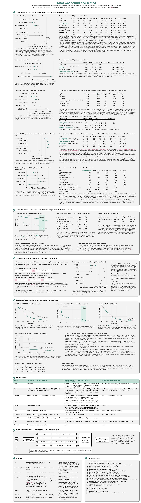

# MusicAutoregresiveModel

An autoregressive symbolic-music transformer. It is pretrained on piano and multi-instrument MIDI (MAESTRO,
GiantMIDI, Aria-MIDI, GigaMIDI, Discover MIDI) and fine-tuned on Ukrainian pop-rock songs, as piano arrangements and as
multi-track band arrangements.

Each position is one note made of compound tokens (pitch, velocity, duration and delta-time on a 20 ms grid). Cascade
output heads predict these, plus the instrument. The window can be conditioned on the instrument set, density and
style. The captioned 450M (musicar-L-caption) also reads a text caption in English or Ukrainian (frozen LaBSE + a
learned adapter), section captions and a requested length in seconds.

**Contents:** [Try it online](#try-it-online) · [Overview](#overview) · [Architecture](#architecture) ·
[What was found and tested](#what-was-found-and-tested) ·
[Comparison with other open models](#comparison-with-other-open-models) · [Pretrained models](#pretrained-models) · [Layout](#layout) · [Setup](#setup) · [Usage](#usage) ·
[Data and licenses](#data-and-licenses)

## Try it online

[musicar-ivory.vercel.app](https://musicar-ivory.vercel.app) writes a piece from a caption in English or Ukrainian
and plays it while the notes arrive (piano roll, SoundFont playback, MIDI and MP3 download). The model runs on my
laptop GPU, so the page writes new pieces only while the laptop is on; it plays the sample pieces otherwise.

Writing pieces needs approval. Open a
[Request access](https://github.com/DmytroHilei/Music_generative_model/issues/new?template=access-request.yml) issue;
once it is labeled `approved`, open the page, go to Settings and press **Sign in with GitHub** with the same account.
Each browser signs in once and keeps its code; one person can have two pieces in progress at a time. Personal invite
links (`…/?invite=…`) work as well.

## Overview

- **Data built:**
  - public MIDI corpora (MAESTRO, GiantMIDI-Piano, Aria-MIDI, GigaMIDI, Discover MIDI) tokenized straight from their
    archives into memory-mapped token stores, ≈ 4.5B unique notes, deduplicated across corpora;
  - a Ukrainian target set built from audio: about 5,900 songs separated into stems (Demucs) and transcribed to piano
    reductions and multi-track MIDI, plus ~700 transcribed piano covers.
- **Models:** from 6M to 450M parameters. The 450M multi-instrument model (RoPE, context 2,048 notes, 129 instruments,
  instrument-set and density conditioning) was trained on 8.3B notes on a rented RTX 5090 (~41 h). Its caption
  fine-tune F1 (captions, section captions, length) added 2.04B notes on the same kind of GPU (~14 h) plus a 600-step
  caption phase (20 min): musicar-L-caption. Everything else, including fine-tuning the 450M on songs, ran on an 8 GB
  laptop GPU (fp8, activation checkpointing, 8-bit optimizer states).
- **Method:** one change per experiment, validation loss per note attribute, generation metrics against the real
  continuation of each song, seed checks and listening tests for final choices. Scaling ladders and iso-FLOP curves
  sized the models, and the forecasts held (107M: predicted 5.47–5.72, measured 5.706).
- **Selected results:**
  - cascade output heads −0.41 nats/note vs independent heads;
  - Muon −0.54 vs AdamW in pretraining, but AdamW for small fine-tunes;
  - RMSNorm + SwiGLU + QK-norm −0.75 over 3 seeds;
  - growing a trained model 2.5–4× faster than training from scratch;
  - the fine-tuned 450M halves the distance to real piano covers vs the earlier best model;
  - head-to-head with other open MIDI models on the same prompts ([comparison](#comparison-with-other-open-models)):
    continuing 96 real multi-instrument prompts over 1,000 new notes, musicar-L (distance D 0.144), musicar-L-caption
    (0.179) and AMT large (0.097) are too close to rank, since the order changes with the prompt subset (on the first 32
    prompts 0.121, 0.218 and 0.289); musicar-L stays closer than SkyTNT medium (0.280) and Music-Llama (0.561). On solo
    piano musicar-L's note rate is closer to the real one than Aria's (D 0.035 vs 0.074). From short captions,
    musicar-L-caption follows better than MIDI-LLM and Text2midi (F 1.07 vs 0.60 / 0.54 in English, 0.95 vs 0.09 / 0.06
    in Ukrainian), but on 495 long MidiCaps test captions it is last on tempo, key and CLaMP 3 (exact key 0.042, at the
    shuffled floor, vs 0.317 / 0.309).
- **Rejected after testing:** mixture of experts, a bigger pitch head, future-prediction heads, velocity augmentation
  (kept in [`musicar/model/rejected.py`](musicar/model/rejected.py) with their results).

Full results: [`docs/experiments.md`](docs/experiments.md).

## Architecture


The model sheet shows the 450M as F1 trained it (musicar-L-caption): 477M trainable parameters, the 464M base with
full attention plus the two caption adapters (13M) and the length tables. The sections are numbered in reading order:

- **1–4: the model.** Captions go through the frozen LaBSE encoder and a small learned-query adapter, and become a
  few vectors inside the note sequence. Each note also gets the instrument and two length levels (seconds left, share
  played). The trunk is 28 pre-norm blocks over compound note tokens. The cascade heads pick Δt, instrument, pitch,
  duration and velocity one after another, each seeing the values already chosen.
- **5: the sequence:** where the file and section caption vectors go, and the length levels of each note.
- **6: generation** with the defaults of `config/generate/f1.toml`: classifier-free guidance 2.5 and the DRY
  repetition penalty per head, the instrument choice (allowed set, lock-instruments), the length and the end (EOS
  floor, ramp and stop), and keep-style (the opening's own description holds the rest of the piece).
- **7–8: glossary and references.**

## What was found and tested



The second sheet holds the evidence behind each part:

- **1: the head-to-head** with other open MIDI models (below).
- **2: F1 and the caption phase:** the F1 curve, what the 600-step caption phase changed (+0.016 nats per note,
  caption following F at guidance 2 from 0.82 to 1.03, 120-s lengths 44% → 56% within 20%), length control, the
  decoding-settings search and the style hold.
- **3: the section-caption recipe.** Change-aware captions, half of the windows spliced from another file, the
  caption repeated every 64 notes and caption words from section statistics take the 107M pilot's switch score from
  0.06 to 0.98. A counterfactual loss was tested and left out (0.85 with splice and repeat, at 1.8× the step time).
- **4: training curves** behind the design choices: trunk block, base pretraining, output heads (the chain is worth
  0.34 nats per note at 42M) and a grouped-query attention conversion (worked at 107M, broke the 450M, so F1 kept
  full attention).
- **5–6: training stages and the audio → MIDI pipeline** that builds the Ukrainian fine-tune set.
- **7–8: glossary and references.**

Both sheets are TikZ / pgfplots: [`docs/figures/architecture.tex`](docs/figures/architecture.tex) and
[`docs/figures/findings.tex`](docs/figures/findings.tex) (PDF and SVG next to them).
[`docs/figures/curves_data.py`](docs/figures/curves_data.py) rebuilds the chart data from the run logs and results,
then `pdflatex architecture.tex` and `pdflatex findings.tex` in `docs/figures/`.

## Comparison with other open models

Every system writes MIDI for one frozen prompt set, and every file is read back from the MIDI and scored the same way,
per note and per second, never per token ([`eval/compare/head2head.py`](eval/compare/head2head.py); the other models run
through the adapters in [`eval/compare/h2h_baselines/`](eval/compare/h2h_baselines) with their authors' sampling
settings).

**Continuation** of the 32 clean GigaMIDI validation prompts (128 notes, ≥ 3 instruments), up to 1,000 new notes
each. D = weighted gap in six row statistics of density and instrument use (takeover, top-instrument share, notes per
second, out-of-band instruments, instrument count, runaway) to the real continuations of the same files, each divided
by the real rows' spread with a floor (lower = closer); runaway = share of rows above 40 notes per second. D is
scored over the first 1,000 new notes and, in the last column, the first 200:

| System | Parameters | Notes / s | Instruments | Out of band | Takeover | Runaway | Copies | D | D, first 200 |
|---|---|---|---|---|---|---|---|---|---|
| real continuation | | 24.0 | 7.7 | 0.15 | 0 | 0.16 | 0.05 | 0 | 0 |
| **musicar-L** | 464M | 23.5 | 6.9 | 0.10 | 0 | 0.13 | 0.14 | **0.121** | **0.090** |
| **musicar-L-caption** (no caption) | 477M | 12.8 | 7.8 | 0.17 | 0 | 0.06 | 0 | **0.218** | 0.198 |
| [AMT large](https://huggingface.co/stanford-crfm/music-large-800k) | 780M | 21.2 | 7.4 | 0.12 | 0.09 | 0.06 | 0.04 | 0.289 | 0.239 |
| [SkyTNT midi-model tv2o-medium](https://huggingface.co/skytnt/midi-model-tv2o-medium) | 234M | 22.9 | 5.3 | 0 | 0.03 | 0.16 | 0.14 | 0.314 | 0.184 |
| [Music-Llama](https://huggingface.co/asigalov61/Music-Llama) (SkyTNT architecture) | 457M | 28.9 | 5.7 | 0.02 | 0.03 | 0.25 | 0.14 | 0.357 | 0.218 |
| [Moonbeam](https://huggingface.co/guozixunnicolas/moonbeam-midi-foundation-model), T 0.9, top-p 0.95 (its README) | 839M | 49.5 | 8.9 | 0.14 | 0.16 | 0.31 | 0.21 | 0.703 | 0.322 |
| Moonbeam, T 0.6, top-p 0.9 (its completion example) | 839M | 85.9 | 5.3 | 0.02 | 0.13 | 0.06 | 0.46 | 1.316 | 0.525 |

musicar-L-caption's distance is mostly density: without a requested length it writes shorter, sparser pieces (12.8
vs 24.0 notes per second). AMT lets one instrument take over 9% of the rows; SkyTNT and Music-Llama add almost no new
instruments and use fewer of them; Moonbeam plays at twice the real density and runs away in 31% of the rows (its
1,024-note context is shorter than prompt + continuation, so the harness restarts its window on the last 768 notes).
At T 0.9 Moonbeam's density climbs inside the first window, before any restart (rows above 40 notes per second: 16%
over its first 200 new notes, 46% over new notes 447–894; real continuations 13% and 18%); at T 0.6 it stays flat
except in 2 files that stack notes on one onset, and it copies more (46% of its new pitched notes inside exact copies
of 16 or more chords). Over the first 200 notes every model is closer to the real continuations; SkyTNT, Music-Llama
and Moonbeam gain most.

**The same continuation on 96 prompts.** The published 32 all come from GigaMIDI's no-drums folder, so 64 prompts were
added, 33 from it and 31 from the with-drums folder, which is the two folders' share of the eligible files. Moonbeam was
not run on these. Each row of the second table is scored against its own real continuations:

| System | Notes / s | Instruments | Out of band | Takeover | Runaway | Copies | D | D, first 200 |
|---|---|---|---|---|---|---|---|---|
| real continuation | 24.5 | 6.9 | 0.12 | 0.02 | 0.11 | 0.12 | 0 | 0 |
| **musicar-L** | 25.1 | 6.0 | 0.07 | 0.02 | 0.13 | 0.14 | 0.144 | **0.084** |
| **musicar-L-caption** (no caption) | 16.4 | 7.1 | 0.13 | 0.02 | 0.05 | 0.01 | 0.179 | 0.205 |
| AMT large | 23.3 | 7.4 | 0.16 | 0.03 | 0.09 | 0.05 | **0.097** | 0.099 |
| SkyTNT tv2o-medium | 25.4 | 4.9 | 0 | 0.03 | 0.18 | 0.15 | 0.280 | 0.161 |
| Music-Llama | 38.2 | 5.0 | 0.02 | 0.04 | 0.38 | 0.12 | 0.561 | 0.219 |

| Prompts | musicar-L | musicar-L-caption | AMT large | SkyTNT medium | Music-Llama |
|---|---|---|---|---|---|
| all 96 | 0.144 | 0.179 | **0.097** | 0.280 | 0.561 |
| the published 32 | **0.121** | 0.218 | 0.289 | 0.314 | 0.357 |
| the new 64 | 0.181 | **0.159** | 0.224 | 0.295 | 0.693 |
| no-drums folder, 65 (most of these have drums) | 0.137 | 0.200 | **0.094** | 0.286 | 0.485 |
| with-drums folder, 31 | 0.246 | **0.199** | 0.371 | 0.316 | 0.846 |
| all 96, first 200 notes | **0.084** | 0.205 | 0.099 | 0.161 | 0.219 |
| the published 32, first 200 | **0.090** | 0.198 | 0.239 | 0.184 | 0.218 |
| the new 64, first 200 | 0.098 | 0.215 | **0.047** | 0.155 | 0.264 |

The published ranking does not hold on the wider set, and no system leads every row. D is a gap between means, so errors
can cancel over a wider set: AMT's 0.097 is below both its 0.289 and its 0.224. In a paired bootstrap over the prompts,
musicar-L is closer than AMT in 26% of the draws (59% at 200 notes) and closer than SkyTNT medium and Music-Llama in all
of them, at both lengths; musicar-L-caption is closer than AMT in 6%, SkyTNT medium in 93% (24% at 200) and Music-Llama
in 100% (54% at 200). These shares are no p-values. musicar-L-caption's gap is density again: 24 notes per second over the
first 200 new notes, 16.4 over 1,000. AMT keeps the prompt's instruments least, which D does not score (0.77 vs real
0.92, musicar-L 0.89).

**Piano continuation** of 32 solo-piano prompts from our held-out split of Aria-MIDI (which Aria may have seen in
training), up to 1,000 new notes each. With one instrument, D here only measures how close the note rate is to the real
one (and runaway):

| System | Parameters | Notes / s | Runaway | Ended | D | D, first 200 |
|---|---|---|---|---|---|---|
| real continuation | | 7.95 | 0 | 0 | 0 | 0 |
| **108M piano-cover fine-tune** (ua_2048_v2, not released) | 108M | 8.39 | 0 | 0.34 | **0.018** | **0.006** |
| **musicar-L** | 464M | 8.95 | 0 | 0.41 | **0.040** | **0.019** |
| [Aria medium](https://huggingface.co/loubb/aria-medium-base) (continuation weights) | 659M | 9.99 | 0.03 | 0.31 | 0.096 | 0.067 |
| 450M piano-cover fine-tune (not released) | 464M | 3.53 | 0 | 1.00 | 0.177 | 0.078 |

The 450M piano-cover fine-tune writes short covers that end (every row ends inside the 1,000 notes), so it is the one
model of ours further from the real note rate than Aria.

On 96 prompts (the 32 + 64 new ones) the order holds at both lengths:

| System | Notes / s | Runaway | Ended | D | D, first 200 | Draws closer than Aria |
|---|---|---|---|---|---|---|
| real continuation | 8.31 | 0 | 0 | 0 | 0 | |
| **108M piano-cover fine-tune** (ua_2048_v2, not released) | 8.61 | 0 | 0.29 | **0.012** | **0.003** | 98% |
| **musicar-L** | 9.19 | 0 | 0.48 | **0.035** | **0.016** | 93% |
| Aria medium | 9.93 | 0.02 | 0.20 | 0.074 | 0.044 | |
| 450M piano-cover fine-tune (not released) | 3.75 | 0 | 0.91 | 0.182 | 0.081 | 0.1% |

**Text to MIDI** from the first note: 28 prompts (15 English and 12 Ukrainian captions and the empty prompt), 16 pieces
each. F = caption following over 9 English and 8 Ukrainian contrasts (higher = follows); caption match = how well a
piece meets what its caption asks, judged with our caption builder's thresholds (so it favours our models); runaway =
share of 10-s windows above 40 notes per second; MIDI-LLM and Text2midi have no length input and stop at their
authors' token budgets:

| System | Parameters | F, English | F, Ukrainian | Caption match | Runaway | Seconds |
|---|---|---|---|---|---|---|
| **musicar-L-caption** (f1 preset, 60 s asked) | 477M (+ frozen LaBSE) | 1.07 | 0.95 | 0.857 | 0.02 | 63.5 |
| **musicar-L-caption** (f1 preset + `--retrieve gigamidi_replay_train`, 60 s asked) | 477M (+ frozen LaBSE) | **1.08** | **1.15** | **0.871** | 0.02 | 49.2 |
| [MIDI-LLM](https://huggingface.co/slseanwu/MIDI-LLM_Llama-3.2-1B) | 1.72B | 0.60 | 0.09 | 0.553 | 0.14 | 35.0 |
| [Text2midi](https://huggingface.co/amaai-lab/text2midi) | 250M (incl. its frozen FLAN-T5 encoder) | 0.54 | 0.06 | 0.554 | 0.09 | 25.2 |

Both other models learned text to MIDI from MidiCaps' English captions and hardly react to Ukrainian ones;
musicar-L-caption reads both languages through LaBSE. With `--retrieve` the caption also picks a real 128-note
GigaMIDI opening that the model continues (not in the file, hence the shorter pieces; for the empty prompt a random
opening of the same files). Two unreleased paths that keep the best of 4 candidates by caption match score higher: our
107M caption pilot (s50, F 1.16 / 1.16, caption match 0.972) and the band fine-tune of musicar-L without text input,
whose caption only picks the opening and ranks the candidates (1.12 / 1.22, 0.981).

**Text to MIDI on MidiCaps test captions.** The prompts above are short and suit our models; these are long English
captions of [MidiCaps](https://arxiv.org/abs/2406.02255), the data both other models learned text to MIDI from. 500 rows
were drawn from the 1,374 test rows outside GigaMIDI's train split, the replay store and any train file with the same
notes; 5 later turned out to share notes with the replay store, so 495 are scored, one file each, on the first 40 s
([`eval/compare/h2h_midicaps.py`](eval/compare/h2h_midicaps.py)). TB to CKD follow
[Text2midi's paper](https://arxiv.org/abs/2412.16526), with tempo and key estimated from the notes because our files
carry no tempo event. That puts even the real files at 0.608 and 0.586, so compare these numbers with each other, not
with the papers'. real = the true files against their own targets (ceiling); shuffled = against another prompt's
(floor). [CLaMP 3](https://arxiv.org/abs/2502.10362) MRR = how well a caption finds its own piece among 100 others;
Fréchet = distance of the files to real ones in CLaMP 3's space ([`eval/compare/h2h_clamp3.py`](eval/compare/h2h_clamp3.py)):

| Score | musicar-L-caption | MIDI-LLM | Text2midi | real | shuffled |
|---|---|---|---|---|---|
| TB: tempo in the asked bin | 0.244 | **0.400** | 0.345 | 0.608 | 0.248 |
| TBT: or a neighbouring bin | 0.620 | **0.640** | **0.640** | 0.739 | 0.600 |
| CK: exact key | 0.042 | **0.317** | 0.309 | 0.586 | 0.051 |
| CKD: or the relative major / minor | 0.075 | **0.420** | 0.378 | 0.636 | 0.099 |
| Instrument recall | 0.425 | **0.664** | 0.426 | 0.809 | 0.167 |
| Family recall | 0.728 | **0.812** | 0.685 | 0.856 | 0.392 |
| Instrument Jaccard | 0.250 | **0.554** | 0.221 | 0.671 | 0.093 |
| Caption match (our thresholds) | 0.526 | **0.609** | 0.557 | 0.711 | 0.388 |
| CLaMP 3 MRR | 0.122 | **0.276** | 0.156 | 0.469 | 0.052 |
| CLaMP 3 Fréchet (lower = closer) | 193 | **112** | 154 | 33 | |
| Runaway (10-s windows) | **0.036** | 0.148 | 0.072 | 0.059 | |

musicar-L-caption is last on tempo, key, caption match and CLaMP 3, and at the floor on tempo bins and key; on instruments
it is level with Text2midi and behind MIDI-LLM. Text2midi's 3 unusable files score 0. On the short English prompts above
CLaMP 3 gives the opposite order (MRR 0.321 vs 0.239 MIDI-LLM, 0.257 Text2midi). The f1 preset was tuned on short prompts and
never on key or tempo words inside long prose, so better settings may recover part of this; that is not tested yet.

Raw scores: [`docs/head2head/`](docs/head2head/README.md).

## Pretrained models

The four models are on Hugging Face under CC BY-NC-SA 4.0, one repository each, with the weights
(`model_bf16.pt` for the scripts here; `model.safetensors` + `config.json` without pickle) and a model card:

| Model | Parameters | Context | Validation (nats / note) | Diagram |
|---|---|---|---|---|
| [musicar-L-caption](https://huggingface.co/Dimitri-206265/musicar-L-caption) | 477M (+ frozen LaBSE 471M) | 2,048 notes, caption (EN / UK), length | captioned GigaMIDI held-out 1.898 | [png](docs/figures/architecture.png) |
| [musicar-L](https://huggingface.co/Dimitri-206265/musicar-L) | 464M | 2,048 notes, 129 instruments | clean GigaMIDI 1.679 | [png](docs/figures/base_450m.png) |
| [musicar-S](https://huggingface.co/Dimitri-206265/musicar-S) | 108M | 129 instruments, RoPE | GigaMIDI 2.232 (original split) | [png](docs/figures/base_107m_band.png) |
| [musicar-S-piano](https://huggingface.co/Dimitri-206265/musicar-S-piano) | 107M | 512 notes, solo piano | Aria-MIDI 5.706 | [png](docs/figures/base_107m_piano.png) |

- **musicar-L-caption:** musicar-L after F1 and its caption phase (`checkpoints/f1_cap`): follows a caption in
  English or Ukrainian and a length in seconds; the app's model.
- **musicar-L:** multi-instrument with window conditions; the base of musicar-L-caption.
- **musicar-S:** the piano model grown to 129 instruments and RoPE; the base of the 107M caption pilots.
- **musicar-S-piano:** solo piano; the earlier model.

```bash
hf download Dimitri-206265/musicar-L-caption --local-dir checkpoints/musicar-L-caption
.venv/bin/python generate.py --config f1 --checkpoint checkpoints/musicar-L-caption/model_bf16.pt \
    --text "a calm jazz piano trio" --length-seconds 60 --output samples/calm_jazz.mid

hf download Dimitri-206265/musicar-L --local-dir checkpoints/musicar-L
.venv/bin/python generate.py --checkpoint checkpoints/musicar-L/model_bf16.pt --sample-instruments \
    --max-new-tokens 1000 --output samples/out.mid
```

The diagrams are [`docs/figures/base_*.tex`](docs/figures) (`figstyle.tex` is the shared style), the cards are in
[`docs/model_cards/`](docs/model_cards).

## Layout

Entry points at the root:

- `train.py` — training (nanoGPT-style configs: `python train.py config/<group>/<run>.py --key=value`)
- `generate.py` — sampling: MIDI + MP3, prompts from files, validation sets or caption retrieval; `--config` presets

`musicar/` — the core package:

| Folder | Contents |
|---|---|
| `model/` | `gpt.py` (transformer, embeddings, cascade heads, KV cache), `checkpoint.py` (paths, loading into a grown model, saving), `rejected.py` (tested-and-rejected options: MoE, future heads, ...) |
| `training/` | `optim.py` (AdamW, AdamW8bit, Muon, LR schedule), `fp8.py` (torchao float8), `memory.py` (selective activation checkpointing, spilling to RAM), `configurator.py` (overrides for train.py) |
| `data/` | `loader.py` (tokenization, memory-mapped token stores, the dataset, window conditions), `midi_io.py` (tokens → MIDI, MIDI → MP3) |
| `text/` | `encoder.py` (frozen LaBSE), `vocab.py` (EN + UK caption vocabulary), `captions.py` (per-file captions) |
| `generation/` | `sampling.py` (KV-cache decoding, CUDA graph, density / instrument / EOS / guidance controls), `piece.py` (generate.py as a library: Generator, note stream), `settings_router.py` (generation settings from the seed song) |
| `serve/` | the app engine (`python -m musicar.serve`): `app.py` (/v1 HTTP API), `jobs.py` (queue, event streams), `tokens.py` (invite tokens: `python -m musicar.serve.tokens add / list / revoke`) |
| `eval/` | evaluations used during training and by the `eval/` scripts |
| `jobstatus.py` | progress files for the dashboard |

Other folders:

| Folder | Contents |
|---|---|
| `config/` | run configs: `pretrain/`, `finetune/`, `pilots/`, `f1/`, `smoke.py` (stacks on any of them); `generate/` = generation presets (TOML); `serve/engine.toml` = the app engine's settings |
| `data/` | datasets, token stores and their metadata (see [`data/README.md`](data/README.md)); `skryabin/` = the hand-picked songs |
| `data_prep/` | `datasets/` (downloads, tokenization into stores, store splits), `songs/` (song search, download, audio → MIDI, fine-tune CSVs), `labels/` (features, labels, pseudo-labels, caption text) |
| `docs/` | experiment results (`experiments.md`), `head2head/` (raw comparison scores), `figures/` (the architecture and findings sheets, per-model diagrams, chart data), `model_cards/` (the Hugging Face model cards) |
| `eval/` | `settings/` (sampling sweeps, settings search), `compare/` (seeded comparisons, text control, sample statistics, the head-to-head with other open models), `probes/` (hidden-state probes, label coverage) |
| `tools/` | `status.py` (dashboard), `sweeps/` (fine-tune sweeps), `bench/` (GPU / CPU throughput), `checkpoints/` (bf16 export, weight interpolation, checkpoint averaging) |
| `cloud/` | rented-GPU pipeline: `setup/` (instance setup, preflight), `run/` (launch, auto-resume, stop), `sync/` (Hugging Face Hub checkpoints and data), `status/` |
| `tests/` | CPU tests per package area: `python tests/run.py [filter]` (or `pytest tests/`) |
| `web/` | the chat page (Next.js, deployed on Vercel); `lib/engine.ts` is its only engine client |
| `legacy/` | earlier LSTM and transformer versions |

`checkpoints/`, `logs/`, `samples/`, `results/` and the data caches are not tracked by git.

## Setup

```bash
uv venv --python 3.12 .venv
uv pip install --python .venv/bin/python -r requirements.txt
uv pip install --python .venv/bin/python --no-deps -e .     # the musicar package
```

MP3 rendering needs `fluidsynth`, `ffmpeg` and a General MIDI soundfont (`fluid-soundfont-gm`).

## Usage

```bash
# train / fine-tune
.venv/bin/python train.py config/finetune/finetune_ua450.py

# sample with a preset
.venv/bin/python generate.py --config caption \
    --text "A melancholic pop rock song with drums, guitar and bass" \
    --num-samples 4 --output samples/out.mid

# live dashboard of runs and jobs
.venv/bin/python tools/status.py

# continue Ukrainian songs, compare
.venv/bin/python eval/compare/seed_compare.py --checkpoints checkpoints/a checkpoints/b \
    --out-dir samples/compare

# whole-song structure metrics
.venv/bin/python -m musicar.eval.structure_eval --checkpoints checkpoints/a
```

### Generation presets

`generate.py --config NAME` loads `config/generate/NAME.toml`, a file of generate.py options (dashes or underscores),
so the long sampling settings don't have to be typed each time. Presets stack (`--config a --config b`, the later one
wins) and any flag given on the command line overrides them, e.g. `--config s50 --cfg-scale 2 --best-of 8`.

| | `f1` | `caption` | `s50` | `piano` |
|---|---|---|---|---|
| **For** | songs from a caption (the app's default) | songs from a caption, borrowed opening | songs from a caption (older pilot) | piano covers of a song |
| **Checkpoint** | `checkpoints/f1_cap` | `checkpoints/multi_control` | `checkpoints/forget_s50_v2` | `checkpoints/overfit_adamw8_1e-4`, it 349 |
| **Model** | F1 after the caption phase, 477M | 450M multi-instrument with instrument-set conditioning, 464M | 107M caption pilot (section arm s50), 119M | 450M piano fine-tune, 464M |
| **Starts from** | the start token (the app: optionally a real opening) | a real 128-note GigaMIDI opening picked by the caption | the start token | the `--prompt` MIDI |
| **Caption** | read by the model, guidance 2.5 | picks the opening and ranks the candidates; the model has no text input | read by the model, guidance 3 | — |
| **Temperature** | 1.1 | 0.85 (default) | 0.9 | 0.9 |
| **Candidates** | 1 | best 1 of 4 by caption match | best 1 of 4 by caption match | 1 |
| **Repetition** | DRY 3 on pitch-class chords | DRY 3 on pitch-class chords | DRY 3 on pitch-class chords | — |
| **Length** | `--length-seconds` (model input), no end before 85% of it, at most 2,048 notes | 1,500 notes | 1,500 notes | 512 notes (default) |
| **Other** | stops a row at 1.2× the length | instruments sampled | instruments sampled | style cover, Δt bias 0.1, density of the prompt |
| **Chosen by** | gen_search 2026-10-28: b19, J 0.786 (b20 0.709, b14 0.560; F1 without the caption phase 0.295, gated out) | listening, 2026-10-24 | cfg 1 / 2 / 3 comparison, 2026-10-24 | listening, 2026-10-12 |

DRY = the repetition penalty of `musicar/generation/repetition.py` (multiplier 3; a passage may repeat 16 chords
verbatim, then the penalty grows 1.15× per further chord). J = F − 0.25 Q, the decoding-settings search score of
`tools/sweeps/gen_search.py`: F = caption following, Q = distance to real songs plus runaway and copy penalties
(results in `results/gen_search/f1/`). Starting `f1` from a retrieved opening (`--retrieve gigamidi_replay_train`) scored J 0.992
vs 0.805 from the start token in the same check; the app has it as the "Real opening" switch.

```bash
.venv/bin/python generate.py --config f1 --text "A melancholic pop rock song with drums, guitar and bass" \
    --length-seconds 60 --output samples/f1.mid
.venv/bin/python generate.py --config caption --text "..." --num-samples 4 --output samples/caption.mid
.venv/bin/python generate.py --config s50 --text "..." --num-samples 4 --output samples/s50.mid
.venv/bin/python generate.py --config piano --prompt song.mid --output samples/cover.mid
```

A new preset is one more `.toml` file in `config/generate/`; unknown option names and invalid values are refused.

## Data and licenses

The training corpora keep their own licenses (MAESTRO, GiantMIDI and Aria-MIDI are non-commercial). Song audio is
downloaded for private research only and is not redistributed. The repository contains only the scripts.
