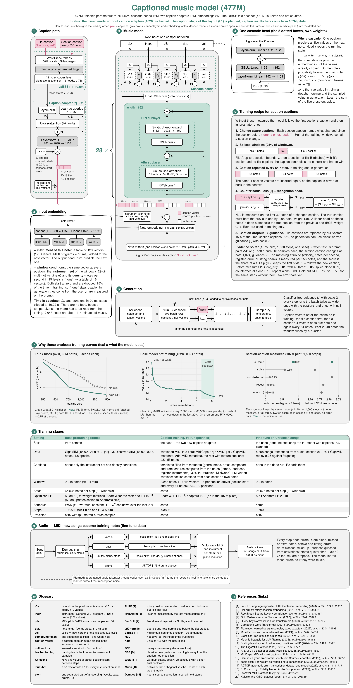

# MusicAutoregresiveModel

An autoregressive symbolic-music transformer. It is pretrained on piano and multi-instrument MIDI (MAESTRO,
GiantMIDI, Aria-MIDI, GigaMIDI, Discover MIDI) and fine-tuned on Ukrainian pop-rock songs, as piano arrangements and as
multi-track band arrangements.

Each position is one note made of compound tokens (pitch, velocity, duration and delta-time on a 20 ms grid). Cascade
output heads predict these, plus the instrument. The window can be conditioned on the instrument set, density and
style.

## Try it online

[musicar-ivory.vercel.app](https://musicar-ivory.vercel.app) writes a piece from a caption in English or Ukrainian
and plays it while the notes arrive (piano roll, SoundFont playback, MIDI and MP3 download). The model runs on my
laptop GPU, so the page writes new pieces only while the laptop is on; it plays the sample pieces otherwise.

Writing pieces needs approval. Open a
[Request access](https://github.com/DmytroHilei/Music_generative_model/issues/new?template=access-request.yml) issue;
once it is labeled `approved`, open the page, go to Settings and press **Sign in with GitHub** with the same account.
Each browser signs in once and keeps its code; one person can have two pieces in progress at a time. Personal invite
links (`…/?invite=…`) work as well.

## Overview

- **Data built:**
  - public MIDI corpora (MAESTRO, GiantMIDI-Piano, Aria-MIDI, GigaMIDI, Discover MIDI) tokenized straight from their
    archives into memory-mapped token stores, ≈ 4.5B unique notes, deduplicated across corpora;
  - a Ukrainian target set built from audio: about 5,900 songs separated into stems (Demucs) and transcribed to piano
    reductions and multi-track MIDI, plus ~700 transcribed piano covers.
- **Models:** from 6M to 450M parameters. The 450M multi-instrument model (RoPE, context 2,048 notes, 129 instruments,
  instrument-set and density conditioning) was trained on 8.3B notes on a rented RTX 5090 (~41 h). Everything else,
  including fine-tuning the 450M, ran on an 8 GB laptop GPU (fp8, activation checkpointing, 8-bit optimizer states).
- **Method:** one change per experiment, validation loss per note attribute, generation metrics against the real
  continuation of each song, seed checks and listening tests for final choices. Scaling ladders and iso-FLOP curves
  sized the models, and the forecasts held (107M: predicted 5.47–5.72, measured 5.706).
- **Selected results:**
  - cascade output heads −0.41 nats/note vs independent heads;
  - Muon −0.54 vs AdamW in pretraining, but AdamW for small fine-tunes;
  - RMSNorm + SwiGLU + QK-norm −0.75 over 3 seeds;
  - growing a trained model 2.5–4× faster than training from scratch;
  - the fine-tuned 450M halves the distance to real piano covers vs the earlier best model.
- **Rejected after testing:** mixture of experts, a bigger pitch head, future-prediction heads, velocity augmentation
  (kept in [`musicar/model/rejected.py`](musicar/model/rejected.py) with their results).

Full results: [`docs/experiments.md`](docs/experiments.md).

## Architecture



The figure shows the captioned layout of the 450M model as F1 will train it: 477M trainable parameters, the 464M
base with full attention plus the two caption adapters (13M).
The sections are numbered in reading order:

- **1–4: the model.** Captions go through the frozen LaBSE encoder and a small learned-query adapter, and become a
  few vectors inside the note sequence. The trunk is 28 pre-norm blocks over compound note tokens. The cascade heads
  pick Δt, instrument, pitch, duration and velocity one after another, each seeing the values already chosen.
- **5: generation**, with classifier-free guidance over the captions.
- **6: the section-caption recipe.** Without it the model follows the first section's caption and ignores later ones.
  Change-aware captions, half of the windows spliced from another file, the caption repeated every 64 notes and
  caption words from section statistics take the 107M pilot's switch score from 0.06 to 0.98. A counterfactual loss
  was tested and left out (0.85 with splice and repeat, at 1.8× the step time).
- **7: training curves** behind the design choices: trunk block, base pretraining, section-caption measures, a
  grouped-query attention conversion (worked at 107M, broke the 450M, so F1 keeps full attention), and the output
  heads (the chain is worth 0.34 nats per note at 42M).
- **8–9: training stages and the audio → MIDI pipeline** that builds the Ukrainian fine-tune set.
- **10–11: glossary and references.**

Status: the music model without captions is trained. The caption stage at 450M (the F1 run) is still planned, so the
caption results in the figure come from 107M pilots. F1 will also add a length-control input (roadmap item 11), not
drawn yet; infilling (item 12) comes in a later fine-tune.

The figure is TikZ / pgfplots: [`docs/figures/architecture.tex`](docs/figures/architecture.tex) (PDF and SVG next to
it). [`docs/figures/curves_data.py`](docs/figures/curves_data.py) rebuilds the curve data from the run logs, then
`pdflatex architecture.tex` in `docs/figures/`.

## Pretrained models

The three pretrained models are on Hugging Face under CC BY-NC-SA 4.0, one repository each, with the weights
(`model_bf16.pt` for the scripts here; `model.safetensors` + `config.json` without pickle), an architecture diagram
and a model card:

| Model | Parameters | What it is | Validation (nats / note) | Diagram |
|---|---|---|---|---|
| [musicar-L](https://huggingface.co/Dimitri-206265/musicar-L) | 464M | multi-instrument (129 instruments), 2,048-note context, window conditions; the base of the planned captioned model | clean GigaMIDI 1.679 | [png](docs/figures/base_450m.png) |
| [musicar-S](https://huggingface.co/Dimitri-206265/musicar-S) | 108M | the piano model grown to 129 instruments and RoPE; the base of the 107M caption pilots | GigaMIDI 2.232 (original split) | [png](docs/figures/base_107m_band.png) |
| [musicar-S-piano](https://huggingface.co/Dimitri-206265/musicar-S-piano) | 107M | solo piano, 512-note context; the earlier model | Aria-MIDI 5.706 | [png](docs/figures/base_107m_piano.png) |

```bash
hf download Dimitri-206265/musicar-L --local-dir checkpoints/musicar-L
.venv/bin/python generate.py --checkpoint checkpoints/musicar-L/model_bf16.pt --sample-instruments \
    --max-new-tokens 1000 --output samples/out.mid
```

The diagrams are [`docs/figures/base_*.tex`](docs/figures) (`figstyle.tex` is the shared style), the cards are in
[`docs/model_cards/`](docs/model_cards).

## Layout

```
train.py              training (nanoGPT-style configs: python train.py config/<group>/<run>.py --key=value)
generate.py           sampling: MIDI + MP3, prompts from files, validation sets or caption retrieval; --config presets
musicar/              core package
  model/              gpt.py (transformer, embeddings, cascade heads, KV cache), checkpoint.py (paths, loading into
                      a grown model, saving), rejected.py (tested-and-rejected options: MoE, future heads, ...)
  training/           optim.py (AdamW, AdamW8bit, Muon, LR schedule), fp8.py (torchao float8), memory.py (selective
                      activation checkpointing, spilling to RAM), configurator.py (overrides for train.py)
  data/               loader.py (tokenization, memory-mapped token stores, the dataset, window conditions),
                      midi_io.py (tokens -> MIDI, MIDI -> MP3)
  text/               encoder.py (frozen LaBSE), vocab.py (EN + UK caption vocabulary), captions.py (per-file captions)
  generation/         sampling.py (KV-cache decoding, CUDA graph, density / instrument / EOS / guidance controls),
                      piece.py (generate.py as a library: Generator, note stream), settings_router.py (generation
                      settings from the seed song)
  serve/              the app engine (python -m musicar.serve): app.py (/v1 HTTP API), jobs.py (queue, event streams),
                      tokens.py (invite tokens: python -m musicar.serve.tokens add / list / revoke)
  eval/               evaluations used during training and by the eval/ scripts
  jobstatus.py        progress files for the dashboard
config/               run configs: pretrain/, finetune/, pilots/, f1/, smoke.py (stacks on any of them);
                      generate/ = generation presets (TOML); serve/engine.toml = the app engine's settings
data/                 datasets, token stores and their metadata (see data/README.md); skryabin/ = the hand-picked songs
data_prep/            datasets/ (downloads, tokenization into stores, store splits), songs/ (song search, download,
                      audio -> MIDI, fine-tune CSVs), labels/ (features, labels, pseudo-labels, caption text)
docs/                 experiment results (experiments.md), figures/ (architecture figure, per-model diagrams, curve
                      data), model_cards/ (the Hugging Face model cards)
eval/                 settings/ (sampling sweeps, settings search), compare/ (seeded comparisons, text control,
                      sample statistics), probes/ (hidden-state probes, label coverage)
tools/                status.py (dashboard), sweeps/ (fine-tune sweeps), bench/ (GPU / CPU throughput),
                      checkpoints/ (bf16 export, weight interpolation, checkpoint averaging)
cloud/                rented-GPU pipeline: setup/ (instance setup, preflight), run/ (launch, auto-resume, stop),
                      sync/ (Hugging Face Hub checkpoints and data), status/
tests/                CPU tests per package area: python tests/run.py [filter]  (or pytest tests/)
web/                  the chat page (Next.js, deployed on Vercel); lib/engine.ts is its only engine client
legacy/               earlier LSTM and transformer versions
```

`checkpoints/`, `logs/`, `samples/`, `results/` and the data caches are not tracked by git.

## Setup

```bash
uv venv --python 3.12 .venv
uv pip install --python .venv/bin/python -r requirements.txt
uv pip install --python .venv/bin/python --no-deps -e .     # the musicar package
```

MP3 rendering needs `fluidsynth`, `ffmpeg` and a General MIDI soundfont (`fluid-soundfont-gm`).

## Usage

```bash
.venv/bin/python train.py config/finetune/finetune_ua450.py                       # train / fine-tune
.venv/bin/python generate.py --config caption --text "A melancholic pop rock song with drums, guitar and bass" \
    --num-samples 4 --output samples/out.mid                             # sample with a preset
.venv/bin/python tools/status.py                                         # live dashboard of runs and jobs
.venv/bin/python eval/compare/seed_compare.py --checkpoints checkpoints/a checkpoints/b \
    --out-dir samples/compare                                            # continue Ukrainian songs, compare
.venv/bin/python -m musicar.eval.structure_eval --checkpoints checkpoints/a   # whole-song structure metrics
```

### Generation presets

`generate.py --config NAME` loads `config/generate/NAME.toml`, a file of generate.py options (dashes or underscores),
so the long sampling settings don't have to be typed each time. Presets stack (`--config a --config b`, the later one
wins) and any flag given on the command line overrides them, e.g. `--config s50 --cfg-scale 2 --best-of 8`.

| preset | model | settings | typical extra flags |
|---|---|---|---|
| `caption` | `multi_control` (band) | the caption picks a real 128-note opening (`--retrieve gigamidi_replay_train`), best 1 of 4 candidates by caption match, DRY repetition penalty on pitch-class chords, 1,500 notes | `--text`, `--num-samples`, `--output` |
| `s50` | `forget_s50_v2` (107M caption pilot) | from the start token, guidance 3, T 0.9, best of 4, DRY, 1,500 notes | `--text`, `--num-samples`, `--output`; `--retrieve gigamidi_replay_train` to start from a real opening |
| `piano` | `overfit_adamw8_1e-4` @349 (450M piano fine-tune) | style cover, T 0.9, Δt bias 0.1, density of the prompt | `--prompt song.mid`, `--output` |

A new preset is one more `.toml` file in `config/generate/`; unknown option names and invalid values are refused.

## Data and licenses

The training corpora keep their own licenses (MAESTRO, GiantMIDI and Aria-MIDI are non-commercial). Song audio is
downloaded for private research only and is not redistributed. The repository contains only the scripts.
